# 나만의 셰이더 제작 — "꿈속의 밤" 세트

몽환적인 판타지 밤 풍경을 주제로, **분야와 원리가 서로 다른 셰이더 6개**를 URP용 HLSL로 직접 작성하고, 이것들을 모아 **"꿈속의 밤 해변" 풍경 씬** 하나를 만들었습니다.

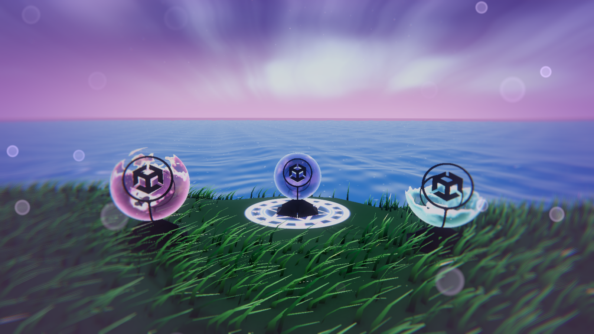

| # | 셰이더 | 분야 | 핵심 원리 | 셰이더 경로 |
| --- | --- | --- | --- | --- |
| 1 | SpiritDissolve | 3D 오브젝트 (셰이더볼) | 조명 + 프레넬 + 3D 노이즈 디졸브, 2패스 투명 | `MyShaders/SpiritDissolve` |
| 2 | DreamyNightSky | 스카이박스 | 시선 방향 벡터로 그리는 절차적 하늘 (해시 별, 노이즈 오로라) | `MyShaders/DreamyNightSky` |
| 3 | MagicCircle | 파티클 이펙트 | UV 극좌표 + SDF 로 그리는 2D 무늬, 가산 혼합 | `MyShaders/MagicCircle` |
| 4 | DreamyScreenFilter | 후처리 (전체 화면) | 화면 이미지 재샘플링: 일렁임, 나선 블러, 색수차, 비네트, 보케 | `MyShaders/DreamyScreenFilter` |
| 5 | SparklingSea | 물 표면 (깊이 사용) | 게르스트너 정점 파도 + 프레넬 반사 + 달빛 윤슬 + 깊이 기반 물가 거품 | `MyShaders/SparklingSea` |
| 6 | FireflyGrass | 정점 변형 | 높이 비례 굽힘 + 흐르는 노이즈 돌풍 + 반딧불 잎 끝 | `MyShaders/FireflyGrass` |

- **풍경 씬** `Assets/00. Scenes/MyShader_DreamyShore.unity`: 여섯 셰이더가 모두 들어간 최종 장면입니다.
  - 밤하늘 아래 반짝이는 바다가 있고, 물가에는 거품이 밀려옵니다.
  - 언덕에는 바람에 물결치는 풀숲이 있고, 가운데 공터의 마법진 위와 그 앞 풀밭에 정령 셰이더볼 3개가 서 있습니다.
  - 화면 가장자리에는 꿈결 필터가 적용됩니다.
- **셰이더별 데모 씬** `Assets/00. Scenes/MyShader_DreamyNight.unity`: 셰이더 1~4를 나란히 보여 줍니다.
  - 밤하늘 스카이박스 아래에 디졸브 셰이더볼 3개와 마법진 파티클, 쿼드, 블룸 볼륨이 있고, 꿈결 화면 필터가 적용됩니다.
  - Play 하면 가운데 볼이 자동으로 사라졌다 나타나고(Auto Dissolve), 마법진은 6초마다 커지며 나타났다 사라집니다.
- **텍스처를 하나도 쓰지 않았습니다.** 노이즈, 별, 룬 문자까지 모두 셰이더 안에서 해시 함수와 수식으로 만듭니다.

```
Assets/02. MyShaders/
├─ 01_SpiritDissolve/   SpiritDissolve.shader, SpiritDissolve.mat (+ _Fairy, _Mist 색 변형)
├─ 02_DreamyNightSky/   DreamyNightSky.shader, DreamyNightSky.mat
├─ 03_MagicCircle/      MagicCircle.shader, MagicCircle.mat (+ _Rose 변형)
├─ 04_DreamyScreenFilter/  DreamyScreenFilter.shader, DreamyScreenFilter.mat, DreamyNight_Renderer.asset
├─ 05_SparklingSea/     SparklingSea.shader, SparklingSea.mat
├─ 06_FireflyGrass/     FireflyGrass.shader, FireflyGrass.mat
└─ DreamyNightVolume.asset   (데모 씬용 Bloom / Vignette / Tonemapping)
Assets/03. DreamyShore/      풍경 씬용 메시(지형, 바다, 풀밭)와 지형 머티리얼
```

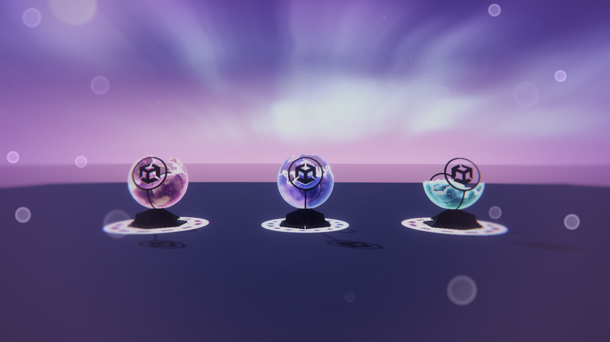

---

## 1. SpiritDissolve — 빛가루로 흩어지는 정령

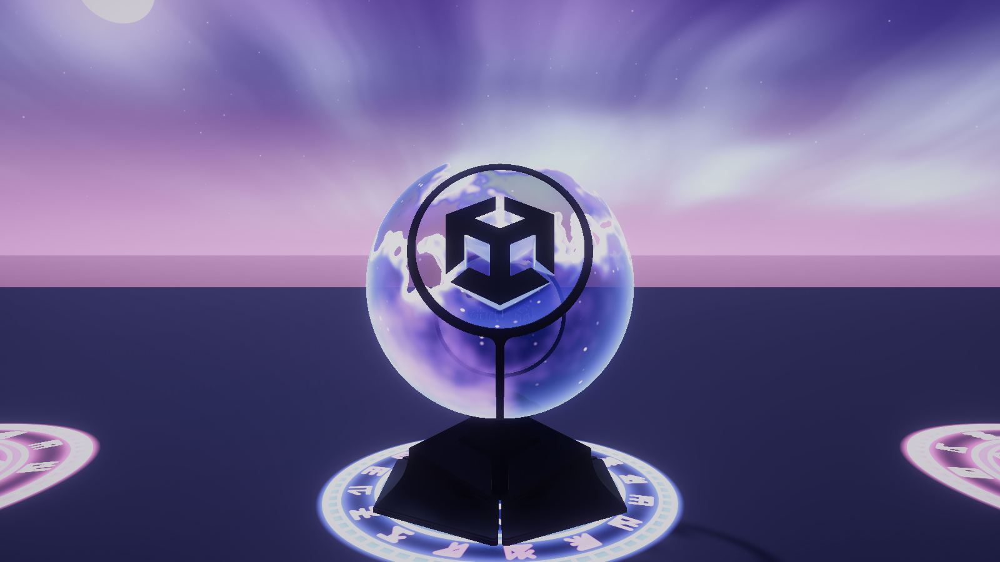

| Dissolve 0 | Dissolve 0.4 | Dissolve 0.7 |
| --- | --- | --- |
| 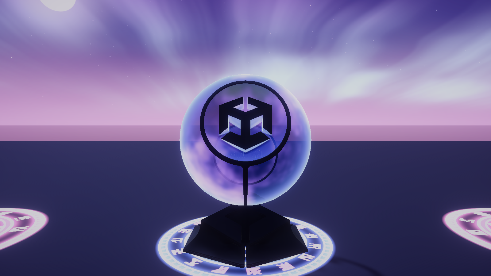 |  | 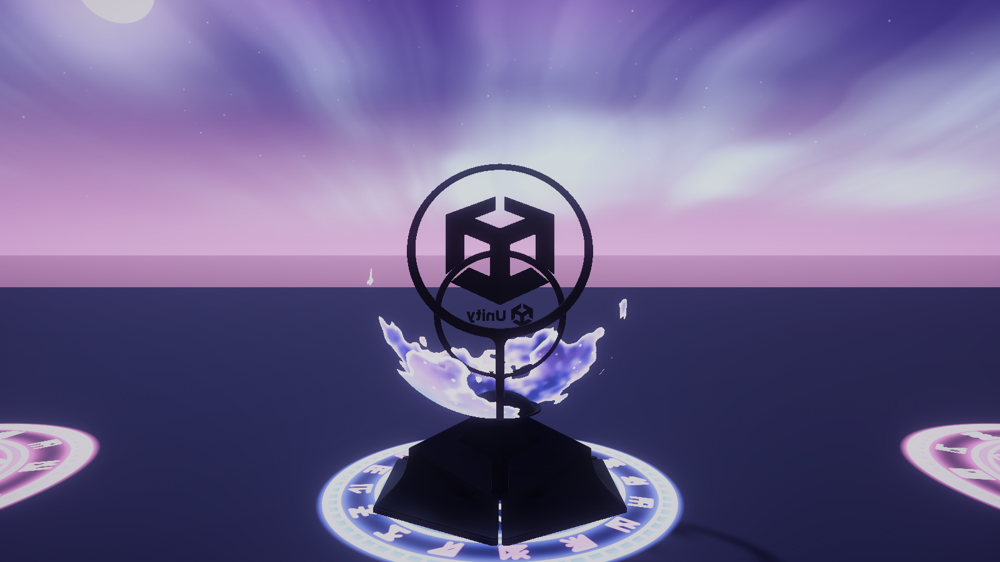 |

반투명하게 빛나는 정령의 몸이 머리부터 빛가루가 되어 사라지는 효과입니다. 갤러리의 **디졸브**, **프레넬 림 빛**, **스크롤·왜곡 에너지** 표본을 응용했습니다.

### 동작 원리

1. **몸 (하프 램버트 조명)**
   `dot(N, L) * 0.5 + 0.5` 로 빛 반대편도 0이 아닌 0.5 근처가 되게 해서, 음영이 부드럽고 몽환적으로 보이게 했습니다. 여기에 `SampleSH(N)` 로 씬의 주변광을 더합니다.
2. **림 라이트 (프레넬)**
   `pow(1 - saturate(dot(N, V)), _RimPower)` — 법선(N)과 시선(V)이 수직에 가까운 가장자리일수록 1에 가까워집니다. 이 값을 색과 **알파 모두에** 더해서 가장자리는 진하게, 가운데는 투명하게 보입니다.
3. **몸 안의 흐름**
   3D 프랙탈 노이즈(값 노이즈 4겹)에 `-_Time.y * _FlowSpeed` 만큼 y 오프셋을 줘서 무늬가 위로 흘러갑니다. `smoothstep(0.5, 0.8, noise)` 로 진한 부분만 남겨 기운이 흐르는 줄기처럼 보이게 했습니다.
4. **디졸브**
   - 비교값 `d = lerp(noise, 1 - height, _HeightInfluence)` — 노이즈에 높이 그라데이션을 섞어 **위쪽부터** 사라지게 했습니다 (하늘로 흩어지는 느낌).
   - `threshold = progress * (1 + EdgeWidth) - EdgeWidth` 로 범위를 넓혀서, 진행값 0에서는 경계선도 보이지 않고 1에서는 완전히 사라지게 했습니다.
   - `clip(d - threshold)` 로 임계값보다 작은 픽셀을 버립니다.
   - 경계 띠 `1 - smoothstep(0, 1, (d - threshold) / EdgeWidth)` 에 따라 **두 가지 색(타는 선 → 식어 가는 색)** 을 그라데이션으로 칠합니다.
5. **반짝이 가루**
   월드 좌표를 작은 격자로 나누고 칸마다 해시값을 구해 10% 칸에만 동그란 빛 알갱이를 그립니다. 해시 입력에 `floor(_Time.y * 8)` 을 더해 1초에 8번 위치가 바뀌며 깜빡이고, 경계 근처에서만 보이게 마스크합니다.
6. **2패스 투명 렌더링**
   - 패스 1 (`SRPDefaultUnlit`, `Cull Front`): 안쪽 면을 먼저, 조금 어둡게 그립니다.
   - 패스 2 (`UniversalForward`, `Cull Back`): 바깥 면을 그립니다.
   - 그래서 디졸브 구멍 사이로 **몸 안쪽 면이 보여** 입체감이 생깁니다. 뒷면에서는 `N = -N` 으로 법선을 뒤집어 조명이 맞게 계산됩니다.

### 직접 바꾸거나 더한 부분
- 갤러리 디졸브는 노이즈만 쓰지만, **높이 그라데이션을 섞어** 방향성 있게 사라지도록 했습니다.
- 경계색을 한 가지가 아닌 **두 색 그라데이션**으로 하고, **반짝이 가루**를 추가했습니다.
- 셰이더볼처럼 **여러 파트로 나뉜 메시**도 무늬가 끊기지 않게 노이즈를 오브젝트 좌표가 아닌 **월드 좌표**로 계산했습니다.
- `Auto Dissolve` 토글: 스크립트 없이 `sin(_Time.y)` 로 진행값을 0→1→0 왕복시킵니다.

### 주요 프로퍼티
`Body Color/Alpha`, `Rim Color/Power`, `Flow Color/Scale/Speed/Strength`, `Dissolve Amount`, `Auto Dissolve`, `Noise Scale`, `Height Influence`, `Height Bottom/Top`, `Edge Width`, `Edge Color (Burn Line / Fade)`, `Sparkle Density/Strength`

---

## 2. DreamyNightSky — 오로라와 별이 빛나는 밤하늘

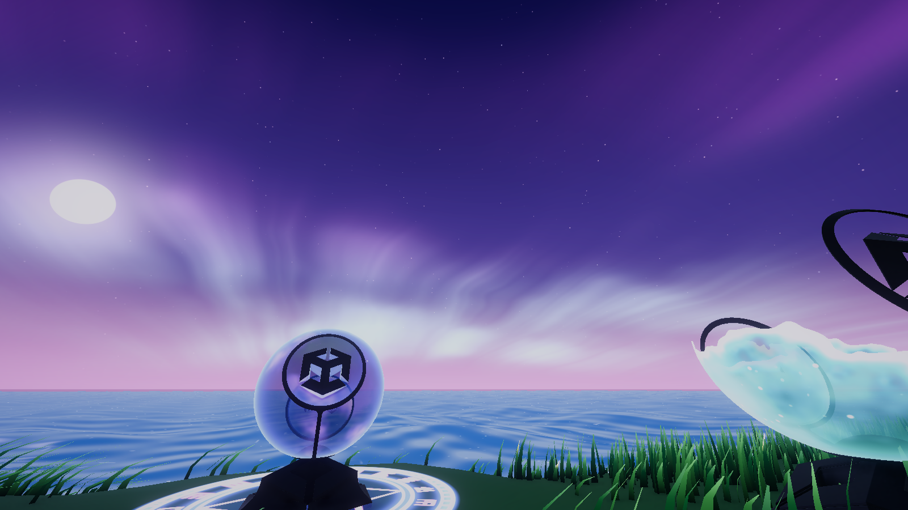

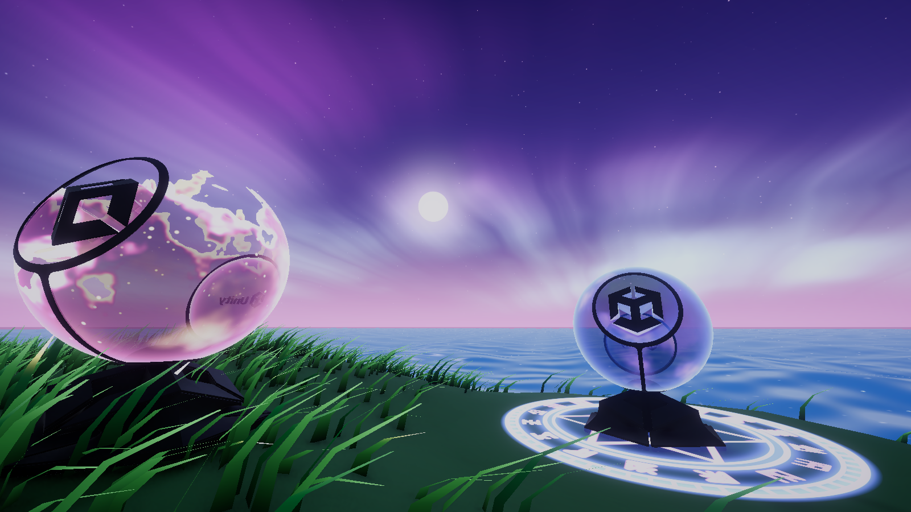

텍스처 없이 **"카메라가 바라보는 방향 벡터" 하나**로 하늘 전체를 계산하는 스카이박스입니다. 갤러리에 없는 분야라 해시, 노이즈, 사인파 기법을 하늘에 맞게 새로 조합했습니다.

### 동작 원리

스카이박스 메시는 카메라를 둘러싼 구라서 **정점 위치 = 바라보는 방향**입니다. 픽셀마다 `dir = normalize(viewDir)` 를 구한 뒤:

1. **3단 그라데이션**
   `dir.y`(높이)로 지평선 → 중간 → 천정 색을 `smoothstep` 으로 섞습니다. 지평선 아래는 땅 색으로 어두워지고, `exp(-|y| * 12)` 로 지평선에 옅은 안개 빛을 더합니다.
2. **별**
   - 방향에 `_StarDensity` 를 곱해 **3D 격자**로 나누고, 칸마다 해시로 `별이 있는지 / 위치 / 크기 / 색 / 깜빡임 위상` 을 정합니다.
   - 칸 안의 별 위치는 0.2~0.8 범위로 제한해 칸 경계에서 잘리지 않게 했습니다.
   - `0.55 + 0.45 * sin(time * speed * (0.5 + rnd) + phase)` 로 별마다 **다른 박자**로 깜빡입니다.
3. **오로라**
   - `uv = dir.xz / (dir.y + 0.25)` — 방향을 머리 위의 가상 평면에 투영합니다. 지평선 쪽일수록 좌표가 커져 원근감이 생깁니다.
   - 띠의 중심선 = `uv.y + sin(uv.x + t) + (노이즈 - 0.5)` 이고, `exp(-curve²)` 로 중심선 근처만 밝은 **구불구불한 띠**를 만듭니다.
   - 중심선 값을 `_AuroraSpacing` 간격으로 나눈 나머지를 써서 띠를 **반복**시켰습니다. 그래서 하늘 어느 방향을 봐도 오로라가 보이고, 띠마다 해시로 밝기를 조금씩 다르게 했습니다.
   - x 방향으로만 촘촘하게 변하는 노이즈를 곱해 **커튼의 세로 주름**을 만들고, 두 겹을 겹쳐 깊이감을 줬습니다.
   - 높이에 따라 아래는 청록, 위는 자홍으로 색이 바뀝니다. 오로라가 밝은 곳은 별을 조금 가립니다.
4. **달**
   - 달 방향과 이루는 각도 `acos(dot(dir, moonDir))` 가 `_MoonSize` 보다 작으면 원판이 됩니다.
   - 가우시안 `exp(-angle²)` 로 은은한 빛무리를 더합니다.

### 주요 프로퍼티
`Zenith/Mid/Horizon/Ground Color`, `Horizon Band Height`, `Star Color/Density/Probability/Size`, `Twinkle Speed`, `Aurora Color (Bottom/Top)`, `Aurora Intensity/Scale/Speed/Sharpness/Max Height/Ribbon Spacing`, `Moon Direction/Color/Size/Glow`

> 적용: `Window > Rendering > Lighting > Environment > Skybox Material` 에 `DreamyNightSky.mat`

---

## 3. MagicCircle — 회전하는 마법진

| 기본 (육망성) | 등장 연출 (Reveal 0.6) | 변형 (_Rose, 5각) |
| --- | --- | --- |
| 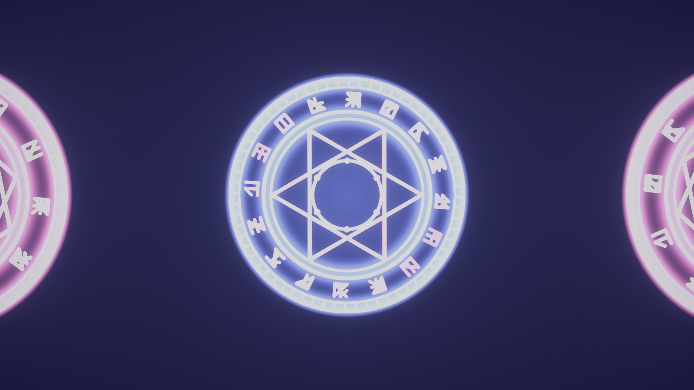 | 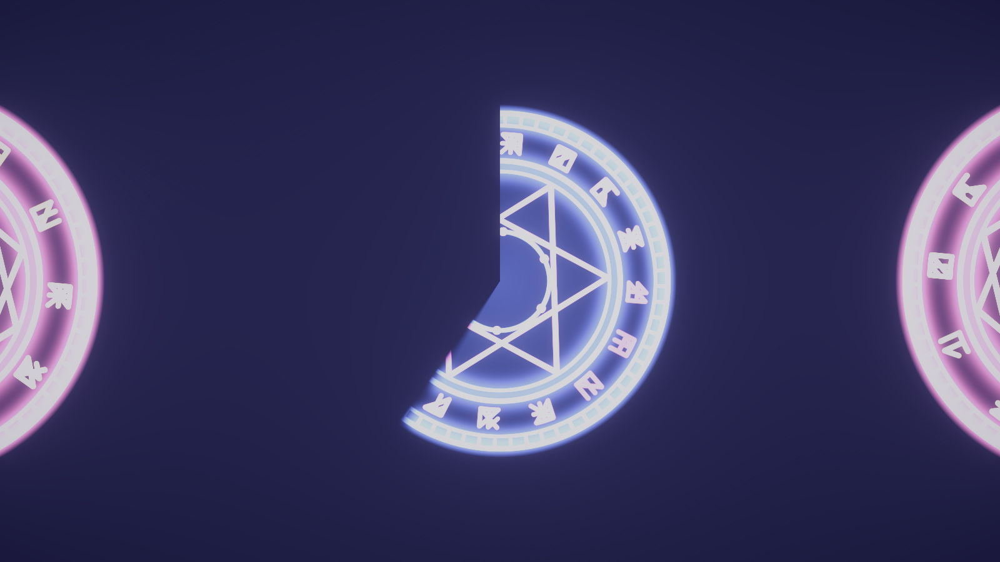 | 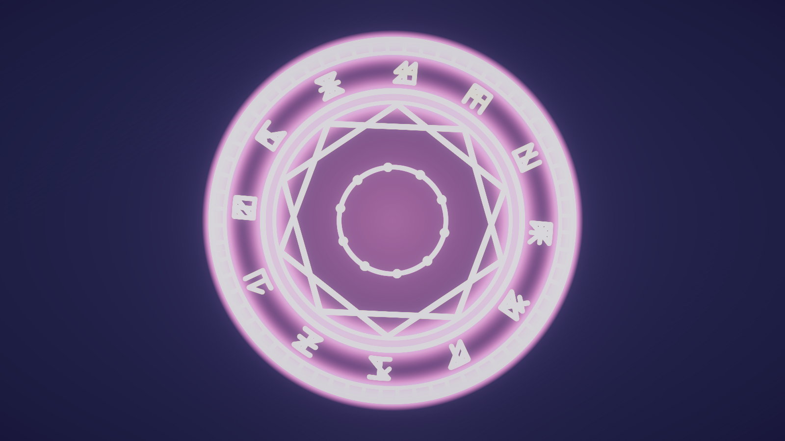 |

고리, 룬 문자, 별 다각형이 서로 다른 방향으로 돌며 맥동하는 마법진입니다. **파티클 시스템**(Horizontal Billboard)에 넣어 쓰고, 일반 쿼드에도 쓸 수 있습니다. 갤러리의 **SDF 도형**, **광택 훑기**(진행값 마스크) 표본을 응용했습니다.

### 동작 원리

1. **극좌표**
   `p = uv * 2 - 1` 로 가운데를 원점으로 옮기고, 반지름 `r = length(p)`, 각도 `atan2(p.y, p.x)` 로 바꿉니다.
2. **SDF 고리**
   - `abs(r - 반지름)` 이 "고리까지의 거리"입니다. 이 값이 선 두께보다 작으면 선으로 칠합니다.
   - `fwidth(r)` 로 한 픽셀 크기를 구해 `smoothstep` 경계 폭으로 써서, 확대하거나 축소해도 **계단 현상 없이** 매끈합니다.
3. **회전**
   - 2D 회전 행렬로 바깥 층(고리 눈금, 룬)과 안쪽 층(별)을 **반대 방향으로** 돌립니다.
   - 가운데 점 고리는 안쪽 층보다 2배 빠르게 돕니다.
4. **눈금**
   각도를 `TickCount` 칸으로 나눈 `frac()` 값이 0.5 근처일 때만 선을 그려, 짧은 눈금이 반복됩니다.
5. **룬 문자 (절차적 글자)**
   - 각도를 `RuneCount` 칸으로 나누고, 칸 번호(`floor`)를 해시해 **3×3 격자 위 획 8개 중 일부를 켭니다**. 그래서 칸마다 다른 글자가 생깁니다.
   - 획은 선분 SDF(`SdSegment`)로 그립니다.
   - 칸의 실제 가로 길이(`2πr / RuneCount`)로 비율을 보정해 글자가 찌그러지지 않습니다.
   - `sin(t - runeId * 0.7)` 로 룬이 원을 따라 **차례로 밝아지는 물결**이 생깁니다.
6. **별 다각형**
   정N각형 테두리 SDF를 `π/N` 만큼 돌린 것과 겹쳐 별을 만듭니다. N=3이면 육망성이 되고, `Star Polygon Sides` 로 3~8각을 고를 수 있습니다.
7. **등장 연출 (Reveal)**
   12시 방향을 0으로 하는 각도값을 `_Reveal` 과 비교해, 마법진이 **시계 방향으로 그려지며 나타납니다**.
8. **빛무리와 맥동**
   - 고리 위치에 가우시안 빛무리를 더하고, 쿼드 가장자리(r=1)에서 0이 되게 해서 네모나게 잘리지 않게 했습니다.
   - `1 + PulseAmount * sin(t)` 로 전체가 숨 쉬듯 밝아졌다 어두워집니다.
9. **파티클 연동**
   - `Blend One One`(가산 혼합)으로 그려서 겹칠수록 밝아집니다.
   - 정점 색 `i.color.rgb * i.color.a` 를 곱하므로, 파티클의 `Color over Lifetime` 알파 곡선으로 페이드 인/아웃됩니다.

### 주요 프로퍼티
`Line Color`, `Rune / Star Color`, `Intensity`, `Halo Strength`, `Line Width`, `Rune Count`, `Tick Count`, `Star Polygon Sides`, `Outer/Inner Rotate Speed`, `Pulse Speed/Amount`, `Rune Wave Speed`, `Reveal`

---

## 4. DreamyScreenFilter — 꿈결 화면 필터

| 필터 끔 | 필터 켬 (기본값) | 강하게 |
| --- | --- | --- |
| 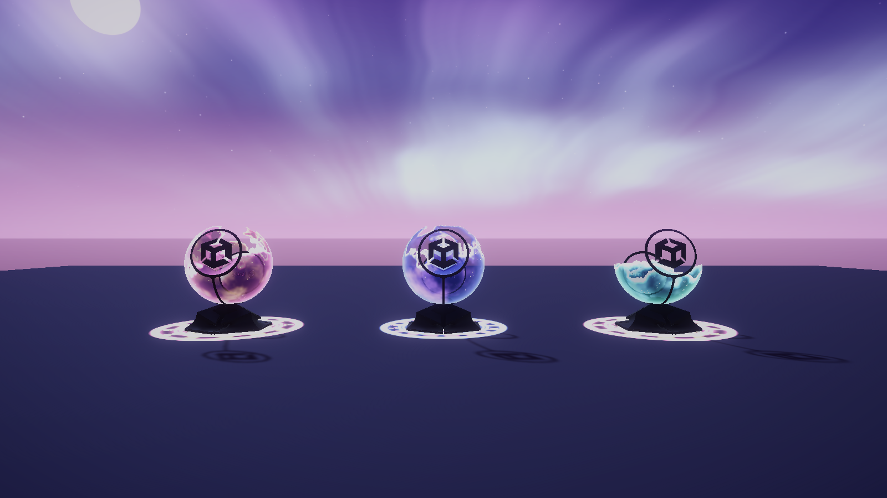 |  | 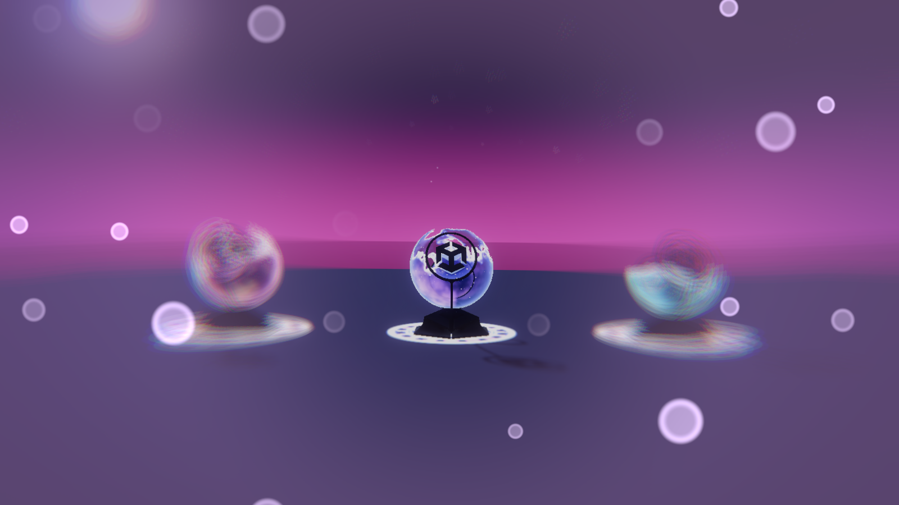 |

물체 하나가 아니라 **카메라가 그린 화면 전체**를 다시 그리는 후처리 셰이더입니다. 화면 가운데는 선명하게 두고, 가장자리로 갈수록 흐려지고 무지갯빛으로 번지며 출렁여서 꿈속이나 회상 장면처럼 보이게 합니다. 갤러리의 **화면 비네트**, **충격파 왜곡**(화면 좌표 왜곡), **배경 블러 유리**(나선 샘플링 블러) 표본을 응용했습니다.

### 적용 방법
- URP Renderer 에셋에 **Full Screen Pass Renderer Feature** 를 추가하고 `DreamyScreenFilter.mat` 을 넣었습니다.
  - Injection Point: After Rendering Post Processing (블룸 이후)
  - Fetch Color Buffer: 켬
- 다른 씬(Study Shader 등)에는 영향이 없도록, `PC_Renderer` 를 복사한 **데모 전용 렌더러** `DreamyNight_Renderer` 를 만들었습니다. 이 렌더러를 `PC_RPAsset` 의 렌더러 목록 1번에 등록하고, 데모 씬 카메라만 이 렌더러를 쓰게 했습니다.

### 동작 원리
Full Screen Pass 가 현재 화면을 `_BlitTexture` 로 넘겨 주면, 화면을 덮는 삼각형 하나를 그리면서 픽셀마다 이 텍스처를 다시 읽습니다.

1. **가장자리 마스크**
   - 화면 가운데에서의 거리를 화면비(`가로/세로`)로 보정해서, 타원이 아닌 **원형** 마스크를 만듭니다.
   - `smoothstep(ClearRadius, ClearRadius + Softness, dist)` 로 가운데는 0, 가장자리는 1이 됩니다.
   - 아래의 모든 효과는 이 마스크만큼 세지므로 **가운데는 선명하게** 남습니다.
2. **일렁임**
   - `sin(uv.y * freq + t)`, `cos(uv.x * freq + t)` 로 읽는 위치(UV)를 조금씩 밉니다. 화면이 물속처럼 출렁입니다.
   - 가운데도 25% 세기로 약하게 움직여, 화면 전체가 살아 있는 느낌을 줍니다.
3. **나선 블러**
   - 주변 픽셀 12개를 읽어 평균 냅니다.
   - 샘플 위치는 각도를 **황금각(약 137.5°)** 씩 돌리고 반지름은 `sqrt(k / N)` 로 키워서, 적은 수로도 원 안에 고르게 퍼집니다.
4. **색수차**
   - 블러 샘플마다 R은 바깥쪽, B는 안쪽으로 조금 밀린 위치에서, G는 그 자리에서 읽습니다.
   - 밀리는 방향이 `uv - 0.5`(화면 가운데에서 바깥 방향)라서, 가장자리로 갈수록 **무지갯빛 테두리**가 벌어집니다.
5. **비네트와 안개**
   - 가장자리 색에 보라색을 곱해(`lerp(color, color * tint, vignette)`) 물들입니다.
   - 마스크만큼 뿌연 분홍빛을 더해, 꿈속 같은 공기감을 줍니다.
6. **보케 빛망울**
   - 화면을 칸으로 나누고, 칸마다 해시로 빛망울의 유무, 위치, 크기, 깜빡임 박자를 정합니다.
   - 가운데보다 테두리가 밝은 원을 그려 렌즈 보케처럼 보이게 합니다.
   - 칸 좌표에서 `t * speed` 를 빼서 빛망울이 **천천히 위로 떠오릅니다**.
   - 원이 칸 밖으로 나가 잘리지 않도록, 크기에 맞춰 위치 범위를 제한했습니다.

### 직접 바꾸거나 더한 부분
- 갤러리 비네트는 가장자리를 어둡게만 하지만, 같은 마스크로 **블러, 색수차, 일렁임, 안개, 보케**를 한꺼번에 조절해 하나의 "꿈결" 연출로 묶었습니다.
- `Intensity` 하나로 모든 효과가 함께 0~1로 변하므로, 이 값만 애니메이션하면 "서서히 꿈에 빠져드는" 전환을 만들 수 있습니다.
- 다른 씬에 영향을 주지 않도록 데모 전용 렌더러로 분리했습니다.

### 주요 프로퍼티
`Intensity`, `Clear Center Radius`, `Mask Softness`, `Wave Amount/Frequency/Speed`, `Blur Radius`, `Chromatic Amount`, `Vignette Tint/Strength`, `Haze Color/Strength`, `Bokeh Color/Strength/Density/Rise Speed`

---

## 5. SparklingSea — 달빛 윤슬이 반짝이는 밤바다

| 달빛 길과 윤슬 | 물가 거품 |
| --- | --- |
| 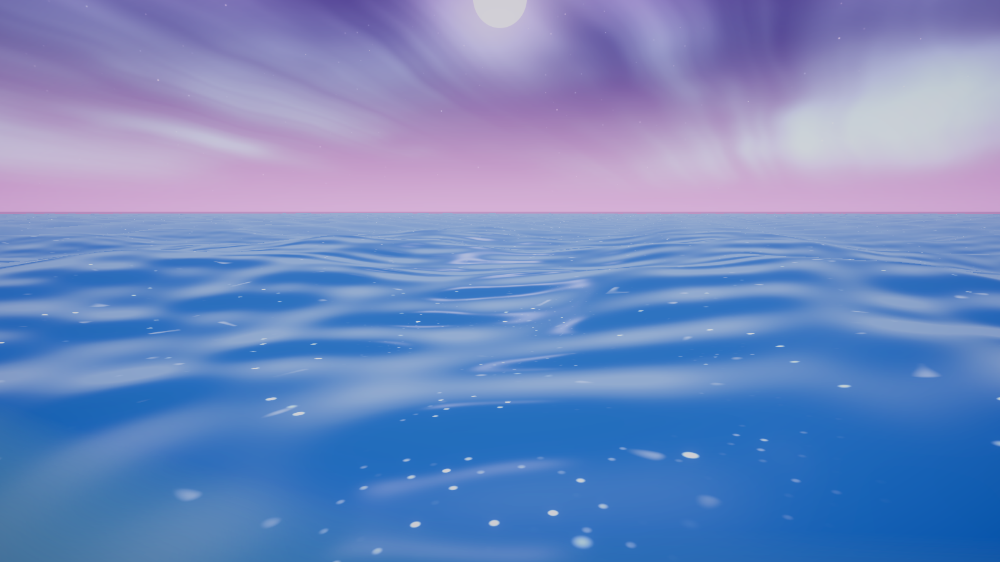 | 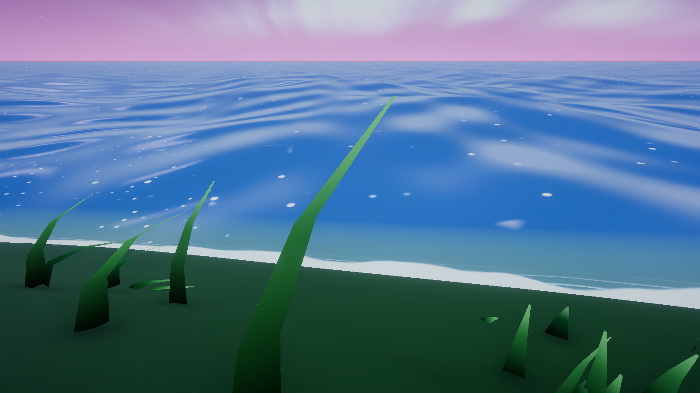 |

천천히 출렁이는 하늘빛 밤바다입니다. 은하수처럼 잔 반짝임이 수면 가득 깜빡이고, 달 아래로 윤슬이 길게 흩어지며, 물이 물체나 물가에 닿는 곳에는 빛나는 거품이 생깁니다. 갤러리의 **물결 수면**과 **깊이 기반 물가 거품** 표본을 응용했습니다.

### 동작 원리
1. **게르스트너 파도 (정점 셰이더)**
   - 파도 4개(방향, 가파름, 파장)를 더해 정점을 움직입니다.
   - 위아래(y)뿐 아니라 진행 방향으로도 원을 그리며 움직이므로, **마루는 뾰족하고 골은 넓은** 실제 파도 모양이 됩니다.
   - 파도 속도는 깊은 물의 물리식 `c = sqrt(9.8 / k)` 를 썼습니다. 그래서 긴 파도일수록 빨리 갑니다.
   - 같은 식을 x, z로 미분한 접선 두 개를 외적해 **법선을 정확히** 구합니다.
   - 월드 좌표로 계산해서 메시를 이어 붙여도 파도가 이어집니다.
2. **잔물결 (픽셀 셰이더)**
   - 서로 다른 방향의 사인파 4개의 **기울기(미분)** 를 더해 법선을 흔듭니다. 텍스처 없는 노멀맵인 셈입니다.
   - 카메라에서 멀수록 약하게 해서, 수평선 근처가 지글거리지 않게 했습니다.
3. **프레넬 반사**
   - Schlick 근사 `0.02 + 0.98 * (1 - N·V)^5` 를 씁니다. 내려다보면 물 색, 비스듬히 볼수록 하늘(밤하늘과 같은 색 + 달)을 비춥니다.
   - 반사 방향 `reflect(-V, N)` 의 높이로 하늘 그라데이션을 구합니다.
4. **달빛 윤슬**
   - 수면을 작은 칸으로 나누고, 칸마다 법선을 해시로 조금씩 기울입니다.
   - 그 법선으로 반사한 방향이 **달을 정확히 향하는 칸만** 반짝입니다.
   - 그래서 달 아래로 반짝임이 길게 늘어서는 **달빛 길**이 저절로 생깁니다.
   - 칸이 화면에서 픽셀보다 작아지면 `fwidth` 로 감지해 줄여서, 멀리서 깜빡이는 노이즈를 막았습니다.
5. **은하수 반짝이**: 달 방향과 상관없이 수면 칸의 일부(22%)에서 하늘빛 점이 별처럼 각자 다른 박자로 깜빡여, 바다에 은하수가 비친 듯한 느낌을 줍니다.
6. **깊이 기반 물가 거품**
   - 깊이 텍스처에서 읽은 "수면 뒤 불투명 물체까지의 거리"에서 "수면까지의 거리"를 빼면 **물속 깊이**가 나옵니다.
   - 이 값이 작은 곳이 물체와 닿는 곳입니다. 노이즈로 끊긴 거품을 그리고, 깊이를 따라 반복하는 줄무늬를 시간에 따라 움직여 **거품이 물가로 밀려오게** 했습니다.
7. **깊이에 따른 색과 투명도**
   - 같은 깊이값으로 얕은 곳은 연한 하늘색에 투명하게, 깊은 곳은 맑은 파랑에 불투명하게 칠합니다.
   - 그래서 물가에서는 물 아래 땅이 비칩니다.
8. **렌더링 순서**
   - 큐를 `Transparent-10` 으로 두고 `ZWrite On` 을 켜서, 다른 투명 물체(정령 볼 등)보다 물을 먼저 그립니다.
   - 그래서 투명 물체가 물에 잠기면 물속 부분은 깊이 테스트에서 가려집니다.

### 주요 프로퍼티
`Shallow/Deep Color`, `Depth Range`, `Shallow Alpha`, `Wave A~D`, `Wave Speed`, `Ripple Scale/Strength/Speed`, `Sky Zenith/Horizon Color`, `Reflection Strength`, `Detail Fade Distance`, `Moon Direction/Color/Highlight Power`, `Glitter Color/Density/Spread/Sharpness/Blink Speed`, `Sparkle Color/Density/Amount/Speed`, `Foam Color/Distance/Noise Scale/Line Speed`

---

## 6. FireflyGrass — 바람에 물결치는 반딧불 풀숲

| 낮은 시점 | 강한 바람 + 반딧불 많이 |
| --- | --- |
| 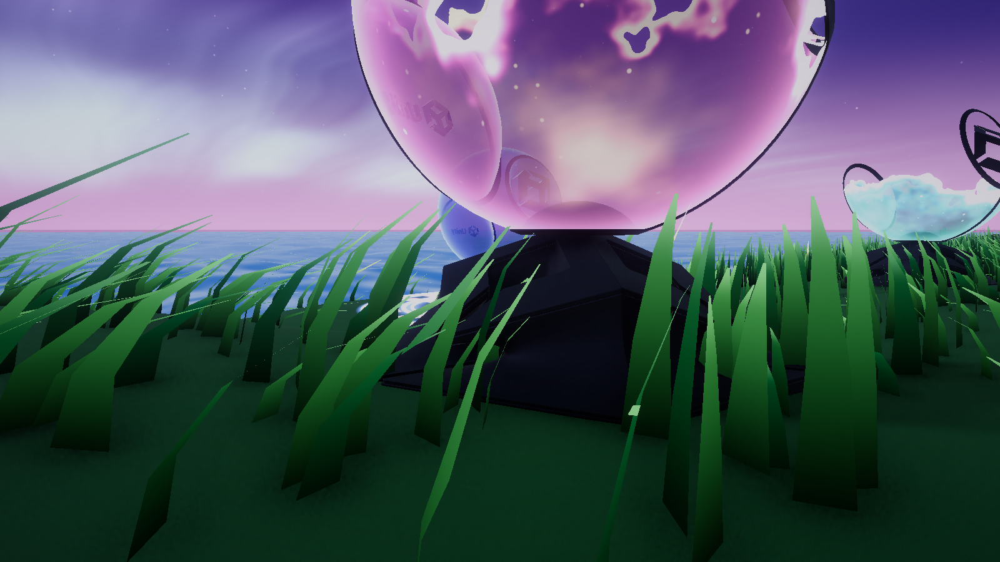 | 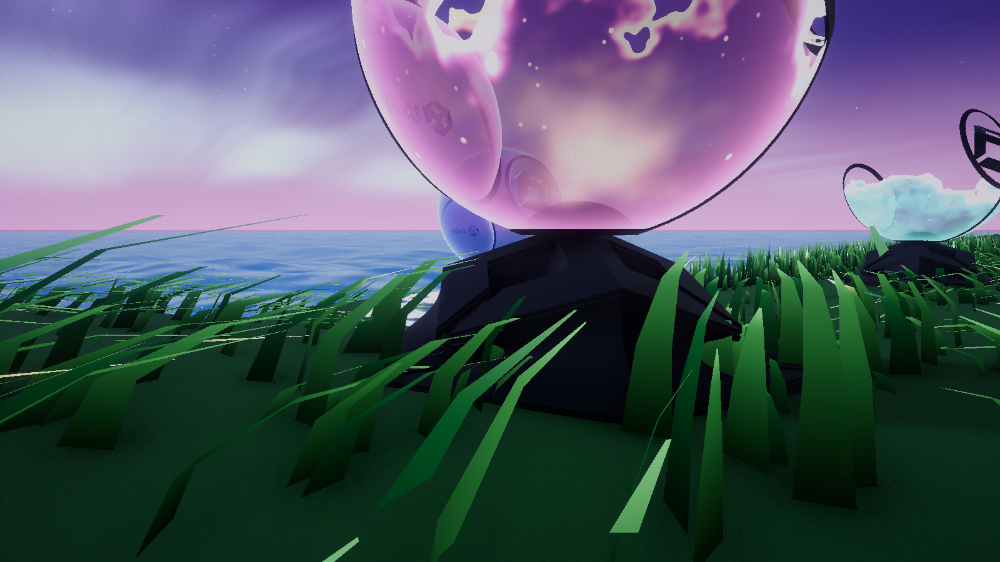 |

풀잎 1만 1천 장이 바람에 함께 눕고 일어나며, 풀밭 위로 바람 물결이 지나갑니다. 일부 잎 끝은 반딧불처럼 깜빡입니다. 갤러리의 **바람 흔들림** 표본을 응용했습니다. 픽셀 색뿐 아니라 **메시의 모양 자체를 바꾸는(정점 변형)** 셰이더입니다.

### 메시 규칙
풀밭 메시는 에디터 스크립트로 만들었습니다.
- 풀잎 = 4단으로 좁아지는 띠입니다.
- `UV.y` = 0(뿌리)~1(끝)입니다.
- 정점 색 R, G = 풀잎마다 다른 난수입니다. 셰이더는 이 값만 보고 흔들림 박자와 색, 반딧불 여부를 정합니다.

### 동작 원리
1. **굽힘 가중치** `UV.y²`
   - 뿌리는 땅에 고정되고 끝으로 갈수록 크게 휩니다.
   - 제곱이라 직선으로 꺾이지 않고 **휘어진 곡선**이 됩니다.
2. **돌풍**
   - 월드 xz 좌표로 2D 노이즈를 읽되 `- 바람방향 * 시간` 만큼 밀어서, 노이즈 무늬 자체가 바람 방향으로 흘러가게 합니다.
   - 노이즈가 큰 곳의 풀이 더 눕기 때문에, 풀밭 위로 **바람 물결이 지나가는** 모습이 보입니다.
3. **팔랑임**: 풀잎 난수로 위상을 바꾼 빠른 사인파를 더해 잎마다 제각각 떨립니다.
4. **길이 보정**: 옆으로 휜 거리만큼 끝을 아래로 내려, 풀잎이 늘어나 보이지 않게 했습니다.
5. **색**
   - 뿌리(진초록)에서 끝(밝은 연두)으로 그라데이션을 줍니다. 일부 풀잎은 끝이 짙은 초록이라 풀밭에 색 얼룩이 생깁니다.
   - 돌풍이 지나가는 곳은 끝이 살짝 밝아져 바람에 눕는 잎이 빛을 받는 느낌을 줍니다.
6. **반딧불**: 난수가 비율보다 큰 풀잎만 끝부분이 각자 다른 박자로 노랗게 깜빡입니다. HDR 색이라 블룸으로 번집니다.
7. **깊이/법선 패스**
   - 정점을 움직이는 셰이더는 `DepthOnly` 와 `DepthNormals` 패스에도 **같은 변형**을 적용해야 합니다.
   - 그래야 깊이 텍스처와 SSAO가 실제로 흔들리는 풀 모양과 어긋나지 않습니다. 세 패스가 같은 정점 함수 `WindVert` 를 공유합니다.

### 주요 프로퍼티
`Root/Tip Color`, `Color Variation`, `Variation Tip Color`, `Tip Glow Color/Strength`, `Wind Direction`, `Gust Strength/Scale/Speed`, `Flutter Amount/Speed`, `Gust Highlight`, `Firefly Color/Ratio/Blink Speed`

---

## 7. 풍경 씬 — 꿈속의 밤 해변

| 꿈결 필터 켬 | 꿈결 필터 끔 |
| --- | --- |
|  | 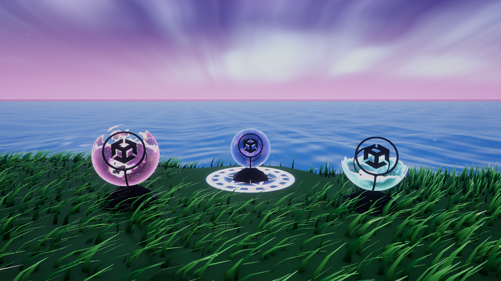 |

| 요소 | 사용한 셰이더 |
| --- | --- |
| 하늘, 오로라, 달 | DreamyNightSky |
| 바다, 윤슬, 물가 거품 | SparklingSea (달 방향을 하늘의 달과 맞춤) |
| 언덕의 정령 볼 3개 | SpiritDissolve (기본 / Fairy / Mist 의 `_Shore` 버전) |
| 언덕의 풀숲 | FireflyGrass |
| 공터의 마법진 | MagicCircle (파티클) |
| 화면 가장자리 | DreamyScreenFilter |

- 지형 높이는 물가가 물결처럼 굽이치도록 수식으로 만들었습니다. 마법진 공터는 평평하게 다듬었습니다.
- 정령 볼은 잘 보이도록 카메라 가까이에 세웠습니다. 가운데 볼은 마법진 위, 양옆 볼은 그 앞 풀밭입니다.
  - SpiritDissolve 의 높이 디졸브는 월드 Y 좌표 범위(`Height Bottom/Top`)를 쓰기 때문에, 볼이 언덕 위에 서면 범위가 어긋납니다.
  - 그래서 볼이 선 높이만큼 범위를 올린 이 씬 전용 머티리얼(`*_Shore.mat`)을 따로 만들었습니다.
- 달빛 방향(Directional Light)도 하늘의 달 방향에 맞춰, 조명, 반사, 윤슬이 모두 같은 달에서 오는 것처럼 보이게 했습니다.

---

## 확인 사항
- Unity Editor 배치 모드로 여섯 셰이더를 컴파일해 **경고 0, 에러 0** 을 확인했습니다.
- 스크린샷은 데모 씬의 카메라로 렌더링한 결과입니다 (`Docs/screenshots/`).
